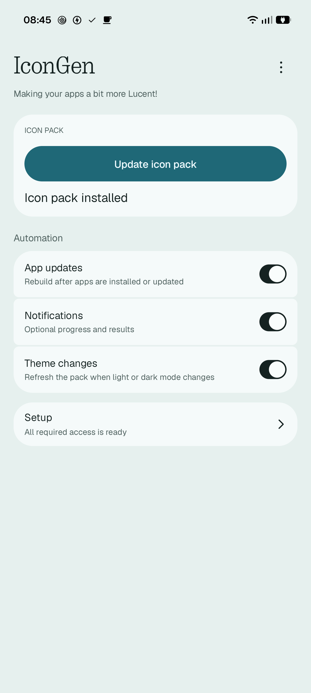
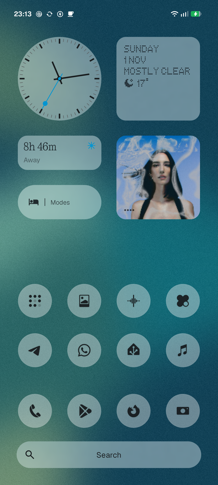
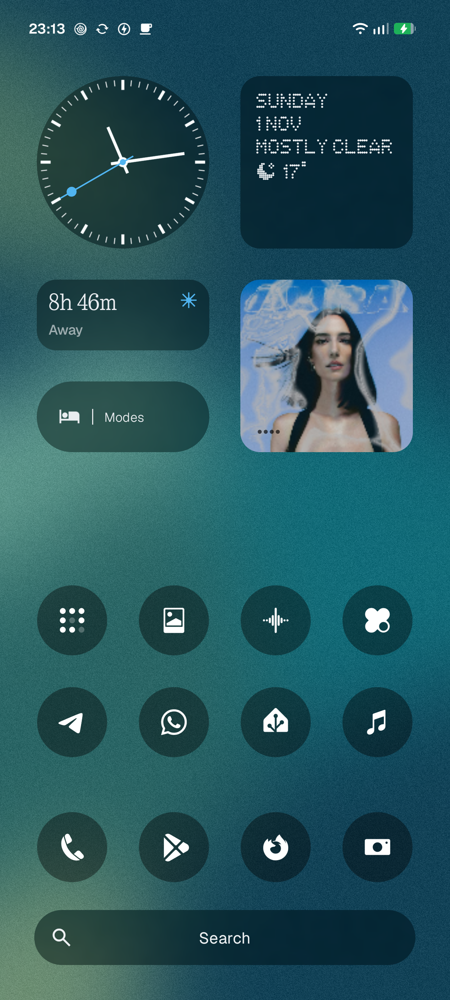

# IconGen: Translucent Nothing Icon Generator

Create and install Nothing OS 5.0-style translucent icons on your phone. Making your apps a bit more Lucent!


## Screenshots

| IconGen app | Light theme | Dark theme |
|:---:|:---:|:---:|
| <a href="screenshots/app-ui.png"></a> | <a href="screenshots/light-theme.png"></a> | <a href="screenshots/dark-theme.png"></a> |

## **ADB INSTALLATION IS MANDATORY**

**You cannot install this APK by downloading it on your phone and tapping Install. Android will reject it with an installation error. You MUST use a PC with ADB and the `--bypass-low-target-sdk-block` option shown below.**

### Requirements

- A Nothing phone running **Android 17 (API 37), arm64**.
- **Nothing Launcher 5.0 or newer**.
- A PC with `adb` for the first app installation. Enable USB debugging and authorize the PC.

Download `IconGen.apk` from [Releases](https://github.com/linuxct/nothing-icongen/releases). Each push publishes a signed build.

Install it with the low-target bypass (the app targets SDK 22):

```sh
adb install -r --bypass-low-target-sdk-block IconGen.apk
```

## Create your pack

1. Follow the guided setup. Choose features, allow installation and **Background icon refresh** if asked, then finish the access steps. Revisit **Setup → Run setup again**.
2. Tap **Create icon pack** (or **Update icon pack**). Approve installation if Android asks.
3. Open **⋮ → Choose in launcher** and select **IconGen Nothing Translucent Icon Pack** once.

The automation switches control app updates, theme changes, and optional notifications. App updates rebuild, install, and apply the pack. Theme changes refresh it without rebuilding.

Applying updated icons and theme refresh need Settings access. Choose PC or wireless setup.

## Settings access: PC

Connect the phone to your authorized PC and run both commands:

```sh
adb shell pm grant space.linuxct.nothing.icongen android.permission.WRITE_SECURE_SETTINGS
adb shell appops set space.linuxct.nothing.icongen WRITE_SETTINGS allow
```

Return to IconGen and check that both grants are confirmed.

## Settings access: wireless

1. Choose **Wireless · on this phone → Wireless setup** during setup. Later, use **Setup → Settings access**. Allow pairing notifications if asked.
2. Tap **Start pairing**. In Settings, enable Wireless debugging on trusted Wi-Fi, then open **Pair device with pairing code**. Enable Developer options if needed.
3. **Keep the pairing dialog open and Settings in front. Do not switch apps or use split screen.**
4. Expand IconGen's notification and reply with the dialog's **six-digit code**. No address or port is needed.
5. Wait for setup to finish, then return to IconGen. Check that **both Settings grants** are confirmed; pairing alone is not enough.
6. Turn Wireless debugging off when done. Use **Stop setup** to cancel if needed.

**Background icon refresh** uses Android's **Display over other apps** permission; IconGen draws no overlay. Only enabled theme monitoring and active wireless setup require silent notifications.

After a force-stop, open IconGen again to resume automation.
